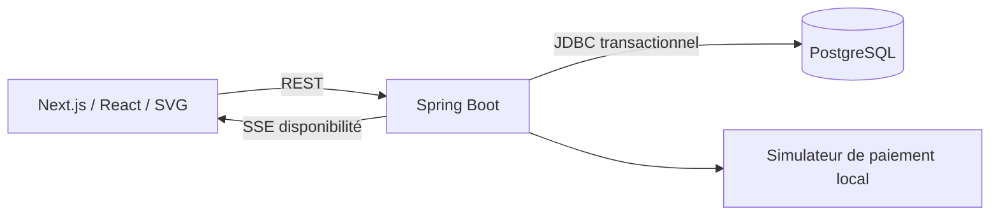
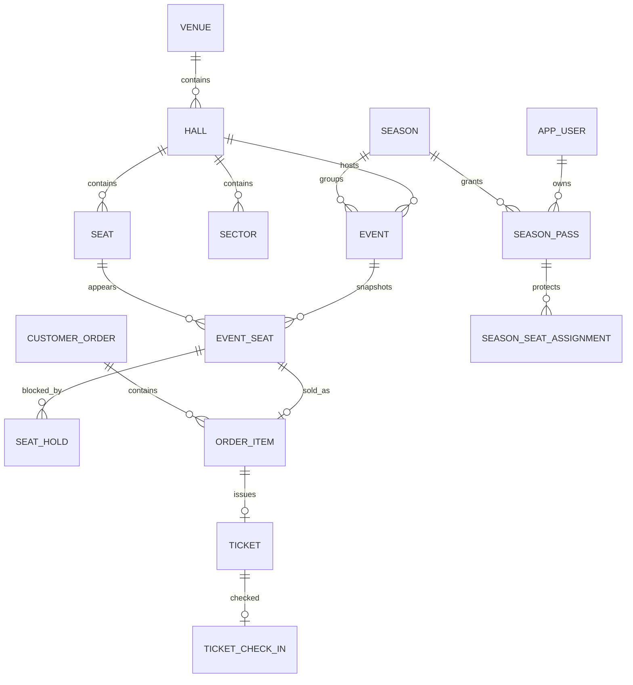
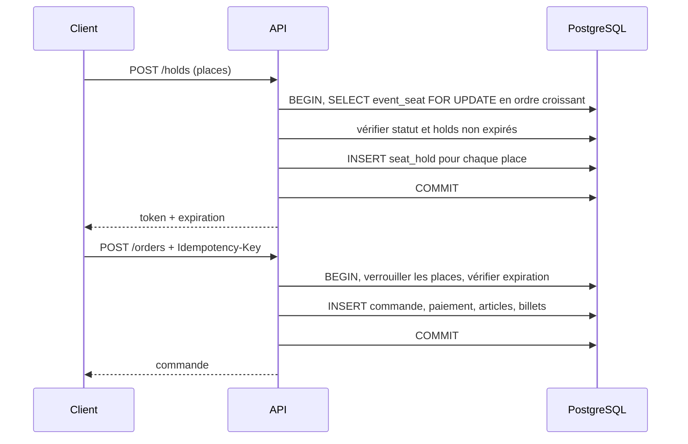
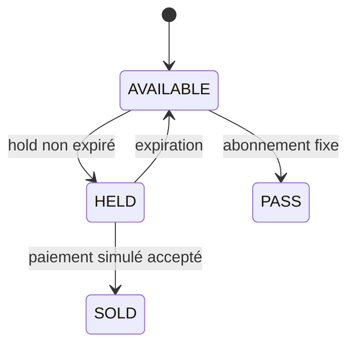
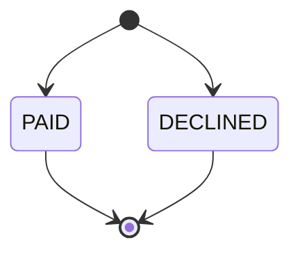
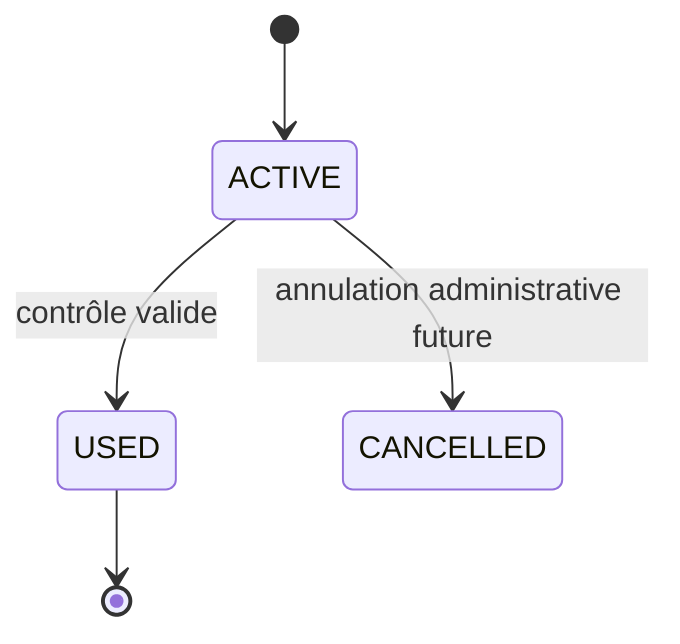

# Architecture

## Modules et responsabilités

`identity` configure les comptes locaux et les rôles ; `event` expose le catalogue et crée les événements ; `reservation` bloque les places et confirme les commandes ; `seasonpass` attribue les abonnements ; `ticketing` valide l'entrée ; `shared` gère les erreurs et le flux SSE. `venue` et `reporting` sont représentés dans le schéma et les endpoints d'administration, mais ne sont pas encore des modules Java séparés.

## Données

La place physique garde son identifiant. `event_seat` fige son prix et sa disponibilité pour un événement. Le plan devient `layout_frozen` à la création d'un nouvel événement via l'API ; l'édition d'une salle n'est pas exposée dans cette version. Les index uniques empêchent un deuxième `order_item` ou billet pour `event_seat`. Le billet contient un UUID imprévisible ; le QR ne contient que ce code.

## Transaction de réservation

Le point de décision est la lecture verrouillée d'`event_seat` suivie de la vérification des holds actifs dans la **même transaction**. Les demandes concurrentes sur la même place se sérialisent. L'index partiel `one_active_hold` ajoute une contrainte de sécurité. Le blocage expire selon `expires_at` en base, même si aucun nettoyage ne tourne. Une erreur avant le commit annule l'ensemble, y compris le paiement simulé et le billet. L'isolation PostgreSQL par défaut est `READ COMMITTED` ; le verrou de ligne rend l'opération sûre pour cette clé.

## États

La machine à états des commandes est volontairement réduite : le paiement simulé est synchrone. Les modes retardé et callback répété du cahier des charges restent à développer.

## Horaires, SSE et sécurité

Les instants sont des `TIMESTAMPTZ`. L'interface utilise `Africa/Casablanca`. La contrainte d'exclusion GiST empêche le chevauchement des périodes occupées, préparation et libération incluses, même sous concurrence. Deux salles distinctes ne se bloquent pas. SSE annonce un changement ; le frontend relit REST après l'événement ou la reconnexion. PostgreSQL reste la source de vérité.

HTTP Basic avec comptes en mémoire est acceptable uniquement pour cette démonstration locale. Les permissions backend sont contrôlées par Spring Security. Pour une application exposée, remplacer par une session serveur avec cookie `HttpOnly`, `Secure`, `SameSite` et protection CSRF, persister les comptes et ajouter TLS. Les secrets sont configurables par variables d'environnement ; la valeur de développement par défaut ne doit jamais être déployée.

## Décisions et limites

| Choix | Alternative | Raison |
|---|---|---|
| Monolithe modulaire | Microservices | Transactions entre réservation et billet simples |
| Verrou de ligne PostgreSQL | Redis seul | La base impose l'invariant durable |
| SSE | WebSocket | Diffusion unidirectionnelle suffisante |
| JDBC explicite | JPA pour chaque requête | SQL de verrouillage et contraintes faciles à auditer |
| Paiement synchrone simulé | Prestataire réel | Démonstration sans argent réel |

Les opérations de modification des salles, cession de billet, annulation et déplacement d'événement, callbacks de paiement, comptes persistants et production sécurisée restent des évolutions. Le frontend ne propose pas encore de formulaire de création d'événement, même si l'API existe.
