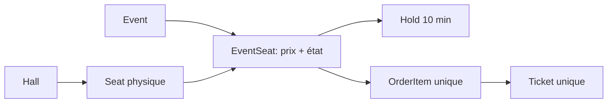

# Guide d'entretien SeatFlow

Légende des affirmations : **[I]** code implémenté, **[T]** test effectivement exécuté et consigné dans `TEST_REPORT.md`, **[P]** évolution prévue. Les affirmations [T] correspondent aux résultats JUnit/Testcontainers ou HTTP consignés dans `TEST_REPORT.md`.

## 1. Le problème métier

**[I]** Une place physique existe dans une salle, mais elle peut être tarifée et occupée différemment pour chaque spectacle. `seat` représente l'objet physique ; `event_seat` est sa projection pour un événement. **[I]** Une vente concurrente peut donc viser la même ligne `event_seat`. Le système doit trancher dans PostgreSQL, pas dans la couleur du bouton de l'interface. **[I]** La place protégée d'un abonnement fixe prend l'état `PASS`. **[I]** Les prix utilisent `NUMERIC(12,2)` et `BigDecimal`, affichés en MAD.



## 2. Du navigateur à la base

**[I]** React charge la fiche et le plan via REST. Le SVG reçoit les coordonnées des sièges et expose une cible clavier avec un libellé détaillé. **[I]** Le client demande un hold pour une liste de places. Le backend trie les identifiants, verrouille chaque `event_seat` avec `FOR UPDATE`, vérifie l'état et les holds non expirés, puis insère tous les holds dans une transaction. Une seule place prise annule toute la demande. **[I]** Le client voit la date limite renvoyée par l'API ; l'autorité reste la date en base. **[I]** À la confirmation, les places sont reverrouillées. Commande, paiement fictif, articles, billets et audit sont écrits avant un même commit. Une exception annule cette écriture.

```mermaid
sequenceDiagram
 Client->>API: réserver sièges 3 et 4
 API->>PostgreSQL: BEGIN; FOR UPDATE 3 puis 4
 PostgreSQL-->>API: lignes verrouillées
 API->>PostgreSQL: vérifier, INSERT holds, COMMIT
 API-->>Client: token, expiration
 Client->>API: confirmer + clé idempotence
 API->>PostgreSQL: BEGIN; FOR UPDATE; INSERT commande/billets; COMMIT
 API-->>Client: commande payée
```

**[I]** Sous `READ COMMITTED`, le second acheteur attend le verrou de la même ligne. Au réveil, il voit le hold actif du premier et reçoit `409`. L'index unique partiel empêche deux holds `ACTIVE` pour la même place ; les contraintes uniques sur `order_item` et `ticket` constituent d'autres barrières. **[P]** Un niveau `SERIALIZABLE` généralisé demanderait une stratégie de retry plus complexe, sans bénéfice nécessaire pour ce point de décision ciblé.

## 3. Horaires, abonnements et pannes

**[I]** Les instants sont des `TIMESTAMPTZ`; le navigateur les affiche en `Africa/Casablanca`. Une contrainte d'exclusion GiST compare les intervalles `[début - préparation, fin + libération)` par salle. Les créations concurrentes qui se chevauchent dans la même salle ne peuvent pas toutes les deux être validées. **[P]** Ajouter un test de changement d'heure propre au fuseau.

**[I]** L'abonnement fixe réserve une place sur tous les événements publiés de la saison au moment de l'achat. Une transaction refuse l'achat si un siège est déjà vendu ou bloqué. Lorsqu'un nouvel événement est créé par l'API, ses affectations fixes sont créées avant le commit. **[I]** L'abonnement prioritaire n'affecte pas de siège ; l'API vérifie sa fenêtre avant `public_opens_at`. **[P]** La cession ponctuelle de billet, l'annulation avec remboursement et les changements tardifs de plan doivent être définis et développés avant production.

**[I]** Une fermeture du navigateur ne modifie pas `expires_at`. Une panne avant le commit de confirmation annule toute la transaction. Une réponse réseau perdue peut être rejouée avec la même clé d'idempotence et renvoie la commande existante. **[P]** Le simulateur n'a pas de réponse retardée ni de callback externe ; une vraie intégration nécessiterait une boîte de réception d'événements idempotente, une machine `PENDING/PAID/FAILED` et probablement un outbox pour les notifications.

## 4. Interface, sécurité, tests et exploitation

**[I]** SSE transporte seulement l'identifiant de l'événement modifié. À la réception ou à la reconnexion, React recharge le plan par REST. Un message SSE perdu n'altère donc pas la décision serveur ; il peut seulement retarder l'affichage. **[I]** L'interface affiche état, légende et libellé de chaque place. **[P]** Des tests automatisés d'accessibilité et de navigation clavier sont encore nécessaires.

**[I]** Spring Security impose les rôles ; les listes de commandes et billets sont filtrées par utilisateur. Les comptes sont en mémoire et HTTP Basic sert seulement en local. **[P]** Une exposition publique demanderait comptes persistants, sessions avec cookies sécurisés, CSRF, TLS, limitation de débit et gestion de secrets de production.

**[I]** Flyway crée le schéma et les données de démonstration ; Docker Compose assemble PostgreSQL, API et frontend. **[I]** Un test Testcontainers de 100 demandes parallèles, répété trois fois, est écrit et vérifie l'état final en base. **[T]** Son exécution a abouti : 5 tests JUnit réussis, dont la concurrence 100 holds répétée trois fois. **[P]** Le plan complet inclut tests d'API par rôle, horaires concurrents, idempotence, frontend, E2E et charge mesurée ; ils ne sont pas encore tous écrits.

## 5. Choix techniques

| Choix retenu | Alternative | Pourquoi |
|---|---|---|
| [I] Monolithe Spring | Microservices | Une transaction couvre l'achat et le billet |
| [I] PostgreSQL avec verrou de ligne | Redis comme arbitre | Durabilité et contraintes au même endroit |
| [I] `TIMESTAMPTZ` | Heure locale sans zone | Un instant reste non ambigu |
| [I] `BigDecimal`/`NUMERIC` | `double` | Évite les erreurs binaires de centimes |
| [I] SSE + relecture REST | WebSocket | Flux serveur vers client seulement |
| [I] Paiement local synchrone | Prestataire réel | Démo sans données bancaires |
| [I] Basic local | Session sécurisée | Simplicité de la démo ; session requise pour production |

## 6. Questions d'entretien avec réponses

1. **Quel problème résout SeatFlow ?** [I] Il réunit catalogue, placement, réservation et contrôle dans un flux cohérent. Le risque central est la double vente d'une place.
2. **Pourquoi `seat` et `event_seat` ?** [I] `seat` conserve l'identité physique ; `event_seat` porte le prix et l'état propres à une représentation.
3. **Où est l'unicité physique ?** [I] Dans `UNIQUE(hall_id,row_label,number)`. Deux places d'une salle ne partagent pas la même désignation.
4. **Où est l'unicité de vente ?** [I] Dans `order_item.event_seat_id` unique et `ticket.event_seat_id` unique ; le service vérifie aussi l'état sous verrou.
5. **Pourquoi un verrou de ligne ?** [I] Les deux demandes de la même place doivent passer l'une après l'autre. `SELECT ... FOR UPDATE` établit cet ordre.
6. **Pourquoi trier les sièges ?** [I] Deux paniers multi-places acquièrent les verrous dans le même ordre, ce qui réduit le risque de deadlock.
7. **Le frontend peut-il garantir l'unicité ?** [I] Non. Deux interfaces peuvent afficher la même disponibilité avant leur demande ; PostgreSQL tranche.
8. **Que signifie HTTP 409 ?** [I] Une demande valide dans sa forme échoue à cause de l'état actuel : place bloquée, vendue ou événement en conflit.
9. **Comment fonctionne le hold de dix minutes ?** [I] La date d'expiration est enregistrée en base. Une requête compare la date réelle à cette valeur.
10. **Un nettoyage est-il nécessaire pour rendre une place libre ?** [I] Non pour la disponibilité : les holds expirés sont ignorés, puis marqués `EXPIRED` sous verrou lors d'une nouvelle demande.
11. **Qu'arrive-t-il à un panier de deux places si l'une est prise ?** [I] La transaction lève un conflit et annule tous les holds du panier.
12. **Pourquoi vérifier l'expiration à la confirmation ?** [I] Le temps peut s'écouler après le blocage. L'achat exige un droit encore valide.
13. **Qu'est-ce qu'une clé d'idempotence ?** [I] Une clé stable pour la même intention de commande. La contrainte `(owner_id,idempotency_key)` évite une seconde commande.
14. **Que se passe-t-il après un double clic ?** [I] Avec la même clé, la seconde requête reçoit la commande enregistrée. Le frontend stocke la clé jusqu'à la réponse.
15. **Et si le réseau perd la réponse ?** [I] Le client peut renvoyer la même clé ; le serveur renvoie la commande existante. [P] La correspondance exacte du corps et de la clé reste à contrôler.
16. **Et si le serveur plante entre paiement et billet ?** [I] Le paiement local et le billet sont dans une transaction ; le commit est tout ou rien. [P] Un paiement externe exigerait une autre stratégie.
17. **Pourquoi `NUMERIC` et `BigDecimal` ?** [I] Les montants décimaux ne doivent pas dépendre de la représentation binaire des flottants.
18. **Pourquoi `TIMESTAMPTZ` ?** [I] Il stocke un instant, que l'interface peut afficher dans un fuseau explicite.
19. **Comment traiter deux spectacles simultanés ?** [I] La contrainte porte sur `hall_id` ; deux salles distinctes peuvent se chevaucher.
20. **Comment intégrer la préparation de salle ?** [I] L'intervalle interdit commence avant `starts_at` et finit après `ends_at` selon les minutes configurées.
21. **Pourquoi une contrainte d'exclusion ?** [I] Elle protège même si deux créations concurrentes passent des vérifications applicatives au même moment.
22. **Que fait un abonnement fixe ?** [I] Il marque `PASS` la même place pour chaque événement publié de la saison et enregistre les affectations.
23. **Que fait un abonnement prioritaire ?** [I] Il ouvre l'accès à la réservation avant le public, sans attribuer de place.
24. **Une place déjà vendue peut-elle devenir un pass fixe ?** [I] Non, l'achat vérifie toutes les places concernées et annule la transaction en cas de conflit.
25. **Que fait l'ajout d'un événement à la saison ?** [I] L'API crée les `event_seat` et les protections des passes fixes avant le commit.
26. **Que contient le QR ?** [I] Un UUID opaque. Il n'y a ni nom ni email dans le code.
27. **Comment empêcher le second scan ?** [I] Le billet est verrouillé, passe à `USED` et `ticket_check_in.ticket_id` est unique.
28. **Pourquoi SSE ?** [I] Le serveur doit signaler des changements au navigateur ; un flux unidirectionnel suffit.
29. **SSE est-il la source de vérité ?** [I] Non. À chaque message, le navigateur relit REST, qui interroge PostgreSQL.
30. **Comment le plan SVG est-il généré ?** [I] Les coordonnées et états viennent de l'API ; React dessine chaque place et gère clic et clavier.
31. **Comment afficher l'accessibilité sans couleur seule ?** [I] La légende et le nom accessible annoncent l'état et le secteur ; la place accessible a un contour spécifique.
32. **Quels rôles existent ?** [I] Client, organisateur, contrôleur et administrateur. Les endpoints sensibles appliquent une autorisation backend.
33. **Un client peut-il lire les commandes d'un autre ?** [I] L'API utilise le principal authentifié dans la requête SQL, sans paramètre de propriétaire fourni par le navigateur.
34. **Pourquoi Flyway ?** [I] Le schéma et le jeu de données sont versionnés et rejouables sur une base neuve.
35. **Comment prouver la concurrence ?** [I] Le test écrit lance 100 tâches au même instant puis lit la base. [T] L’exécution Testcontainers a réussi (5 tests, 0 échec) et le scénario HTTP de 100 acheteurs a donné une vente sur trois répétitions.
36. **Quelle est la différence entre test de charge et test de concurrence ?** [I] Le test de concurrence vérifie un invariant précis ; [P] la charge mesurera latence et erreurs sur une durée définie.
37. **Pourquoi Docker Compose ?** [I] Il fournit la même version de PostgreSQL et Java aux démonstrations locales.
38. **Quelle est la limite de sécurité principale ?** [I] HTTP Basic avec mot de passe de démo. [P] Passer à une session sécurisée et à des comptes persistants avant toute exposition.
39. **Comment gérer l'annulation d'un événement vendu ?** [I] L'API actuelle ne l'expose pas. [P] Définir remboursement, invalidation et notification explicites.
40. **Comment faire évoluer l'architecture ?** [P] Ajouter un vrai flux de paiement idempotent, un outbox, des tests complets et une observabilité utile avant toute distribution.

## 7. Questions pièges et réponses honnêtes

1. **« Votre test de 100 acheteurs est-il passé ? »** [T] Oui pour le script HTTP local : trois séries de 100, une vente chacune, vérifiées en base. Le test JUnit/Testcontainers de 100 holds a aussi réussi trois répétitions.
2. **« Le simulateur gère-t-il vraiment une notification répétée ? »** [P] Non. La répétition de la requête de confirmation est idempotente, mais il n'y a pas de webhook asynchrone.
3. **« HTTP Basic suffit-il en production ? »** [P] Non. Le choix est limité à localhost et aux comptes de démonstration.
4. **« Le QR est-il infalsifiable ? »** [I] Il est difficile à deviner grâce à l'UUID ; l'API valide son état en base. [P] Un contrôle hors ligne nécessiterait une signature et une gestion différente.
5. **« Que se passe-t-il si SSE manque un événement ? »** [I] La reconnexion relit REST. Un retard visuel reste possible ; la décision d'achat se fait en base.
6. **« Une date Casablanca est-elle toujours UTC+1 ? »** [I] Non ; l'interface utilise la zone IANA. [P] Un test de transition horaire doit encore être ajouté.
7. **« Le plan est-il vraiment versionné ? »** [I] Les places et prix d'événement sont matérialisés et l'API n'offre pas de modification des sièges. [P] Une vraie gestion de versions de plans et de migration des événements reste à faire.
8. **« Les ventes sont-elles possibles sur deux places sans contention ? »** [I] Les verrous portent sur chaque `event_seat`. [P] Un test concurrent de places distinctes doit confirmer ce comportement mesuré.
9. **« Un abonnement fixe donne-t-il automatiquement un billet QR ? »** [I] Il protège la place. [P] L'émission d'un billet individuel pour chaque événement de l'abonnement manque encore.
10. **« Le projet est-il complet selon le cahier des charges ? »** [I] Non. Les limites sont listées dans l'architecture et le rapport ; je démontre uniquement le parcours codé et vérifié.
